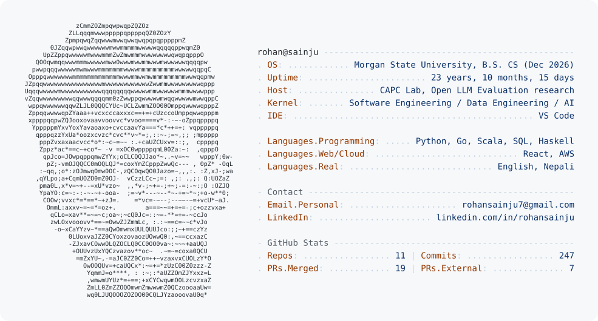

<picture>
  <source media="(prefers-color-scheme: dark)" srcset="dark_mode.svg">
  <source media="(prefers-color-scheme: light)" srcset="light_mode.svg">
  
</picture>

CS senior at Morgan State building LLM evaluation tooling and data pipelines. Open to SWE, data engineering, and AI roles (Dec 2026).

### Featured projects

- **[anchordb](https://github.com/rosaiju/anchordb)**: transactional key-value storage engine in Go with a WAL, skip-list index, crash recovery, and checkpoints
- **[relayflow](https://github.com/rosaiju/relayflow)**: durable workflow engine in Python with PostgreSQL leases, crash recovery, and a React dashboard
- **[multimodal-academic-advisor](https://github.com/rosaiju/multimodal-academic-advisor)**: senior capstone; multimodal AI advisor where degree progress comes from a deterministic rules engine, not the LLM
- **[whaletrack](https://github.com/rosaiju/whaletrack)**: concurrent SEC EDGAR insider-trading scanner in Go
